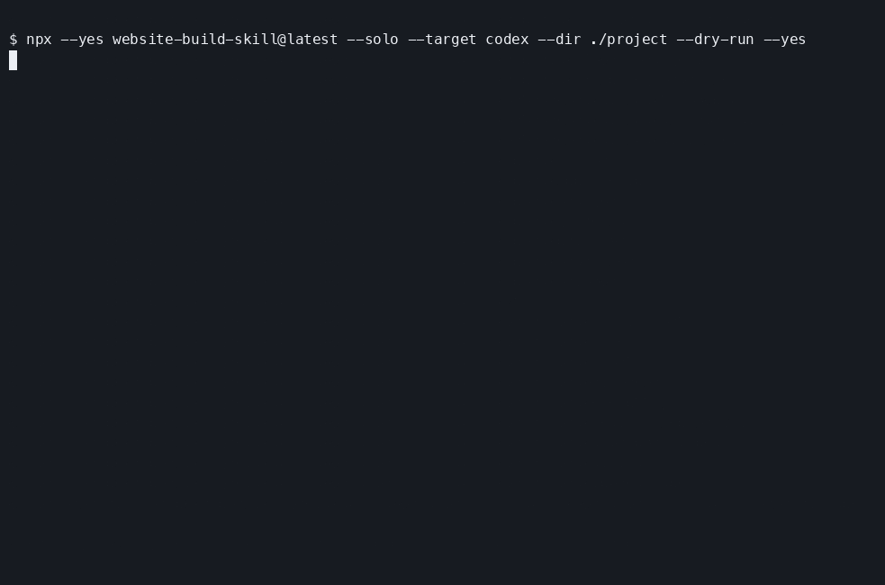

# Installer contract

`npx website-build-skill` copies the canonical files, verifies them by read-back and writes a
receipt of exactly what it wrote. Open the chosen host and ask it to read the installed entrypoint.
See [compatibility](COMPATIBILITY.md) for host setup evidence and loading checks.
TEAM: one command installs the seven workers' files; you open each session yourself and carry the handoffs between them. Researcher goes first.

## What the installer asks

Run without `--solo` or `--team` and the installer prints this menu from `skills/website-build-skill/templates/install-choice.txt`, then asks for the work mode, the target and the save location. `--solo` or `--team`, `--target` and `--output-dir` answer them in advance. The installed SKILL.md does not repeat the menu; the agent follows the recorded choice.

```text
How do you want to work?

  1  Teach my AI          One AI learns the whole thing and does every job itself.
                          Works with any AI: Claude, ChatGPT, Grok, Cursor, Copilot.
                          Nothing else to install.

  2  Give me the team     Seven role prompts (you run each session), one per job, starting with a researcher that gets them all current.
                          Needs Claude Code, Codex, Hermes, Antigravity, or Grok Bot.
                          One command installs their files; you open each session yourself.

Not sure? Pick 1. Moving to 2 later keeps everything you have already done.

Where should the work be saved?

  1  Obsidian vault       Give an existing folder inside your vault. The library is
                          plain Markdown, so it opens and links natively.

  2  A folder on this computer
                          Give an existing directory. The default is the
                          website project folder.

  3  Notion               Working copy still lives in a folder on this computer,
                          because every gate reads its own files back by path.
                          Notion receives an export of the finished library.

  4  Somewhere else       Type an existing local destination yourself.

Whatever you pick becomes the workspace root. Everything below is written inside it.
```

## Manual copy

Copy the complete `skills/website-build-skill/` directory into a new, empty destination:

| Target | Project destination | User destination (`--scope user`) | Loading step |
| --- | --- | --- | --- |
| Claude Code | `.claude/skills/website-build-skill/` | `~/.claude/skills/website-build-skill/` | Read back the entrypoint and assets |
| Codex | `.agents/skills/website-build-skill/` | `~/.agents/skills/website-build-skill/` | Inspect discovery and invocation |
| Hermes | `.agents/skills/website-build-skill/` | `~/.hermes/skills/website-build-skill/` | Check trust and shared discovery |
| Google Antigravity | `.agents/skills/website-build-skill/` | `~/.gemini/config/skills/website-build-skill/` | Inspect discovery, or ask the session to read the entrypoint |
| Gemini CLI | `.gemini/skills/website-build-skill/` | `~/.gemini/skills/website-build-skill/` | Trust workspace and inspect `/skills list` |
| Generic agent / portable | `.website-build-skill/` | `~/.website-build-skill/` | Read the entrypoint and preserve existing routers |
| Grok file-capable host | `.grok/skills/website-build-skill/` | `~/.grok/skills/website-build-skill/` | Read back the entrypoint, or paste the bundles |

Do not merge into a conflicting directory. Compare and preserve existing files first.
Copy a router pointer into existing project instructions only with authorization; do not replace them.
Confirm the host can read the copied entrypoint and assets before beginning.
For chat-only hosts, attach the five bundles and use the [Project instructions](../adapters/chatgpt-project.md).

## Command interface

Install from npm:

```bash
npx website-build-skill --solo --target codex --dir . --scope project --yes
npx website-build-skill --team --target antigravity --dir . --scope project --yes
npx website-build-skill --team --target gemini-cli --scope user --yes
```

This recorded install GIF uses the published 0.1.13 package (SOLO, Codex target), ending on the receipt read-back of 57 files (current releases ship 58 skill files, plus 5 bundles and 7 native subagent definitions on supported `--team` targets).



For unreleased changes, use `npx github:aunysillyme/website-build-skill` with the same flags.
Append `#<reviewed-commit-sha>` to the repository reference for a reproducible install.

- Choice: mutually exclusive `--solo` / `--team`; no arguments asks the canonical human question first.
- Target: `claude-code`, `codex`, `hermes`, `gemini-cli`, `antigravity`, `grok`, `agents`, `chatgpt`, `portable`.
- Scope: `project` by default; `user` requires explicit `--scope user` selection and resolves against the canonical user home directory when `--dir` is omitted (`claude-code`: `~/.claude/skills/website-build-skill/`, `codex`: `~/.agents/skills/website-build-skill/`, `hermes`: `~/.hermes/skills/website-build-skill/`, `gemini-cli`: `~/.gemini/skills/website-build-skill/`, `antigravity`: `~/.gemini/config/skills/website-build-skill/`, `grok`: `~/.grok/skills/website-build-skill/`, `agents`/`portable`: `~/.website-build-skill/`, `chatgpt`: `~/website-build-skill-upload/`).
- Subagent definitions (`--team`): generated for `claude-code` (`.claude/agents/website-<role>.md`), `codex` (`.codex/agents/website-<role>.toml`), `gemini-cli` (`.gemini/agents/website-<role>.md`), and `antigravity` (`.agents/agents/website-<role>.md` for `project`, `~/.gemini/config/agents/website-<role>.md` for `user`), using the same base root (`--dir` or user home).
- Destination: `--dir` is explicit for `--scope project`; optional with `--scope user`. `--bundle-dir` is accepted only for the Hermes team alias and resolves relative to the installed skill folder. Paths outside that folder are refused with exit 3 and "Path escapes destination root".
- Output root: `--output-dir` selects an existing directory separately from the skill destination. Interactive setup collects the save-location choice and path; Enter on the local-folder path uses the website project directory. The receipt records `outputRoot` and optional `outputStorage` (kind and Notion export target). Researcher consumes those values before writing `<outputRoot>/site-work/research/library/scope.md`. The installer only probes the root; it does not create a library or export to Notion. Headless setup without `--output-dir` leaves the root unset for Researcher to ask before writing.
- Notion: export destination only. Interactive setup requires both the existing local working directory (authoritative) and a page URL or name for later export. No credentials are requested and no network upload occurs.
- Writability: confirm the output root by writing and reading back before any sweep; an unwritable root fails without partial writes.
- Headless: `--yes` requires mode, target and either `--dir` or `--scope user`; EOF and missing arguments fail without writes.
- Preflight: validate the entire intended output set before writes; reject symlinks, traversal and conflicts.
- Paths: the project root you name is canonicalized, so a symlinked ancestor such as macOS `/tmp` installs normally. Every segment at or below that root is refused when it is a symlink, because that is what a third party can plant in an install target.
- Idempotence: identical bytes are a no-op; changed bytes produce a reviewable diff without overwriting.
- Dry run: `--dry-run` makes no writes, including directories, receipts or aliases.
- Runtime: offline after package retrieval; no telemetry, profiles, background tasks or lifecycle hooks.
- Receipt: list every actual path and digest, mode, target, definition and unresolved activation check.
- Integration: preserve existing routers and emit a named integration snippet; unmerged means activation pending.
- Interruption: record truthful partial results; never advertise an all-or-nothing transaction without evidence.
- Exit policy: 0 complete, 2 invalid input, 3 preflight conflict, 4 interrupted write, 5 activation pending. 5 is a completed install whose integration snippet is unmerged, not a failure.
- Uninstall: receipt-based, removing only files this package actually wrote (including generated `--team` subagent files) whose bytes still match the receipt. A file that was already on disk before the install, and therefore recorded as identical, is kept: installing it was a no-op and removing it would be taking something that is not ours. A changed file is kept and named, and so is a file the receipt does not list. It removes empty directories it created inside the destination and generated subagent directory; preexisting directories and parent roots are preserved. `--uninstall` accepts `--target <target> --scope user` without `--dir`.
- Earlier Antigravity installs: releases up to 0.1.24 wrote `--target antigravity` to `.website-build-skill/`. Remove such an install with `--uninstall --receipt .website-build-skill/.website-build-skill-receipt.json`, because `--target antigravity --dir` now points at `.agents/skills/website-build-skill/`.
- Destination and custom `--receipt`: decided by `--target` and `--dir` (or `--scope user`), or by where the receipt sits when only `--receipt` is given at the default destination path. A custom `--receipt <path>` stored outside the destination directory requires `--target` and `--dir` (or `--scope user`) alongside `--receipt`. Paths are never trusted outside the verified target root, so an edited or planted receipt cannot redirect removal elsewhere.
- Read-back: every file is re-read from disk and digested after the write pass. A digest taken from the bytes the installer meant to write is a record of the intention, not of what is on disk, and the receipt only ever carries the second one.
- Ownership across runs: a reinstall that writes fewer files keeps owning what an earlier run wrote, so a SOLO install over a TEAM install does not orphan the bundles or generated subagent files.

## TEAM sessions and handoffs

The command copies the complete role files, five bundles, and (for `claude-code`, `codex`, `gemini-cli`, and `antigravity`) seven native subagent definitions. Open each worker's session
or invoke generated subagents from your main session, and carry handoffs between them.
Start Researcher first; carry its passing receipt and library to Coordinator before
passing assignments to later workers. Record seven setup acknowledgements and prefer a
different-family Reviewer (`independent-review: INTERNAL (UNVERIFIED)` is permitted when a second model family is unavailable). Enforce read-only review through host controls or a read-only packet.
The Hermes alias copies bundles into the explicitly selected directory inside the skill folder.
Session references and permissions require your own checks in the chosen host.
See [Google Antigravity](../adapters/antigravity.md), [Gemini CLI](../adapters/gemini-cli.md), [Hermes](../adapters/hermes.md) and [team ownership](../adapters/team.yaml).

## Verify the installation

Run the local checks with `npm run check` and `npm test`. The installer tests cover traversal
and symlink refusal, whole-set conflict refusal, idempotent reruns, dry-run behavior, output-root
writability, receipt digests, changed-file preservation during uninstall and router integration.
After installing, compare the receipt with files on disk and follow your adapter's loading check.
Record client-trial evidence in [compatibility](COMPATIBILITY.md).
