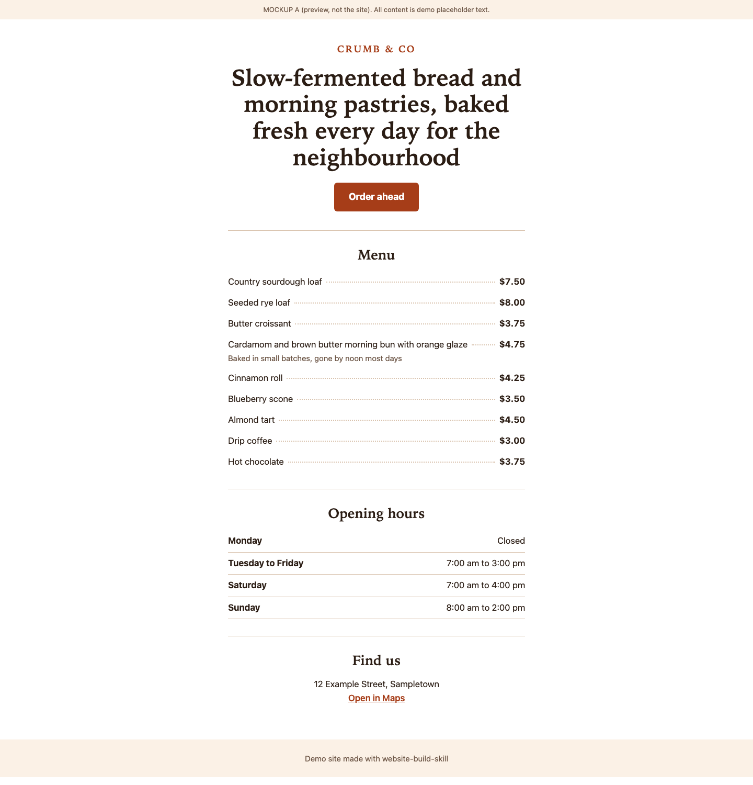
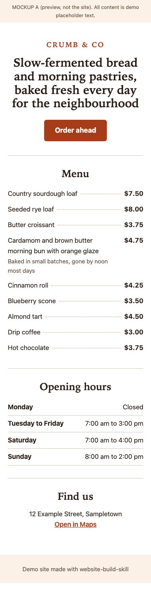
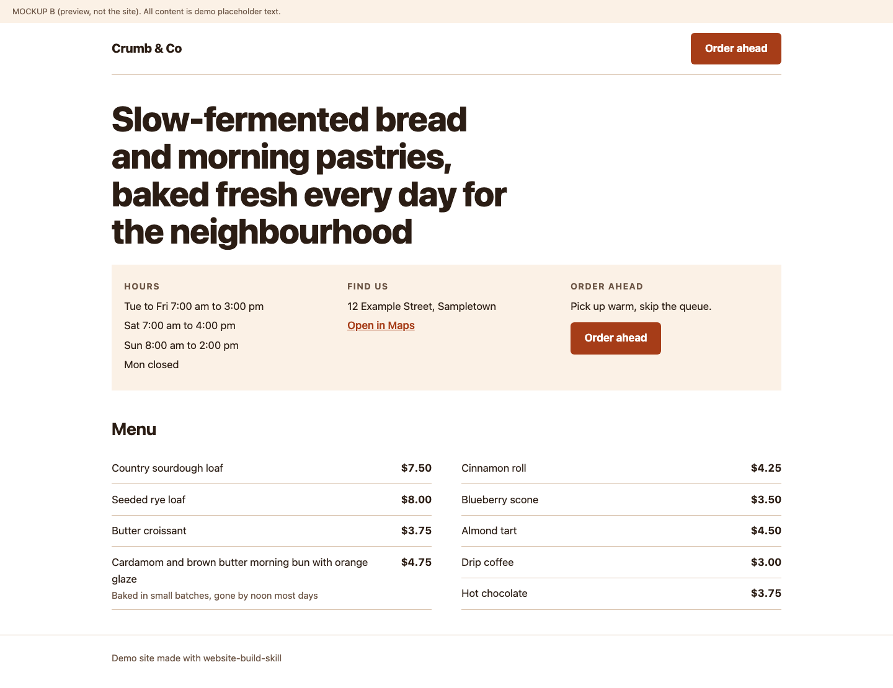
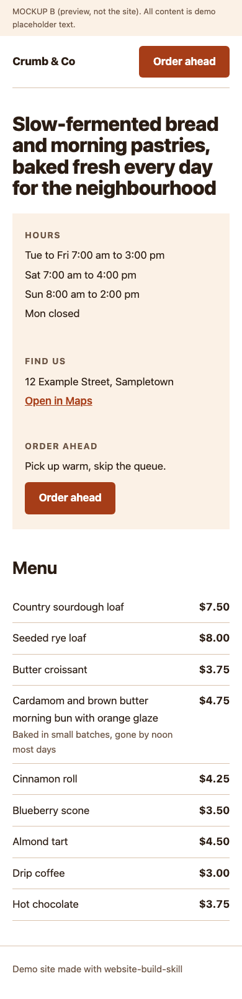
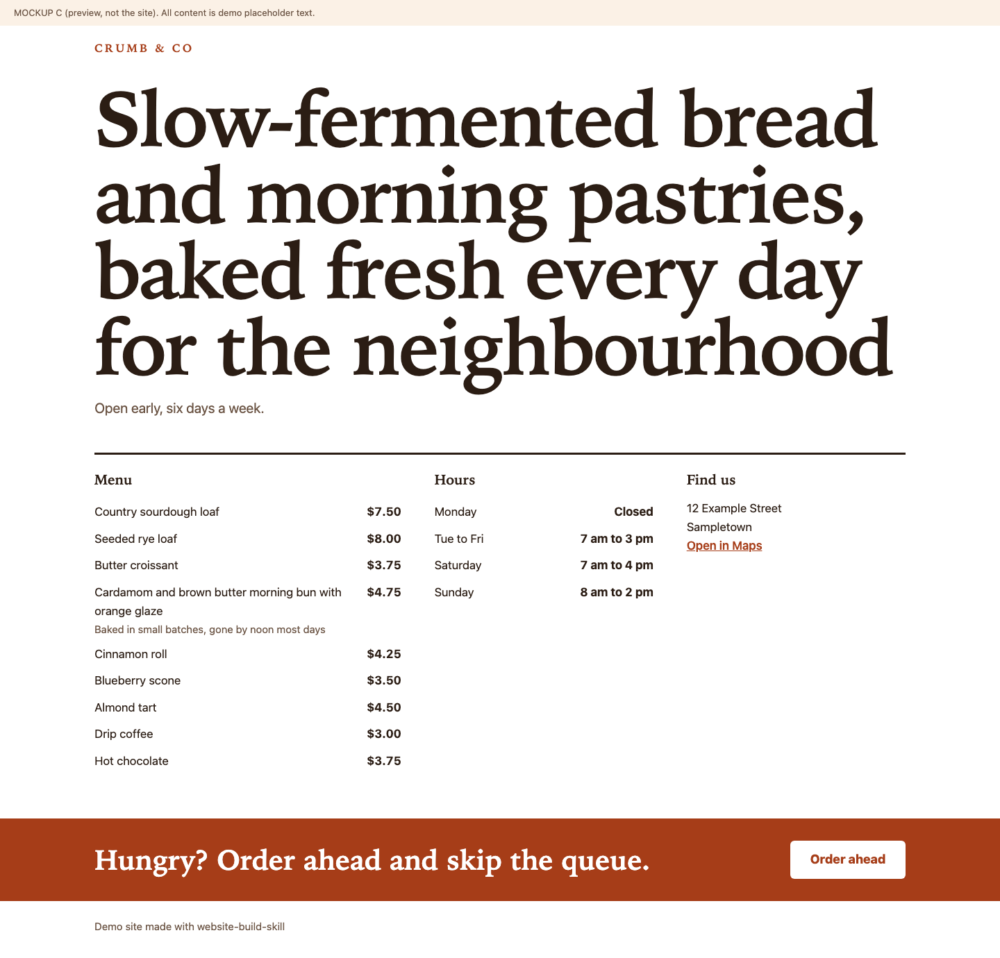
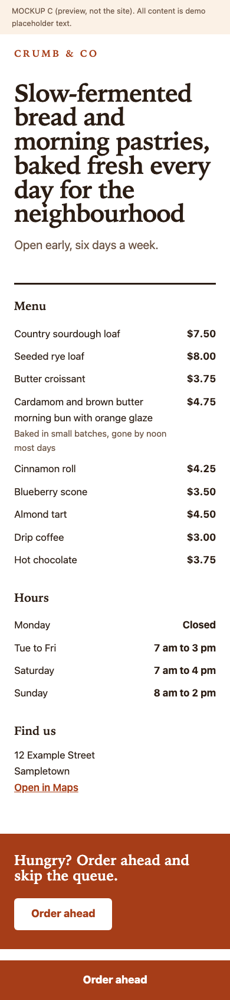
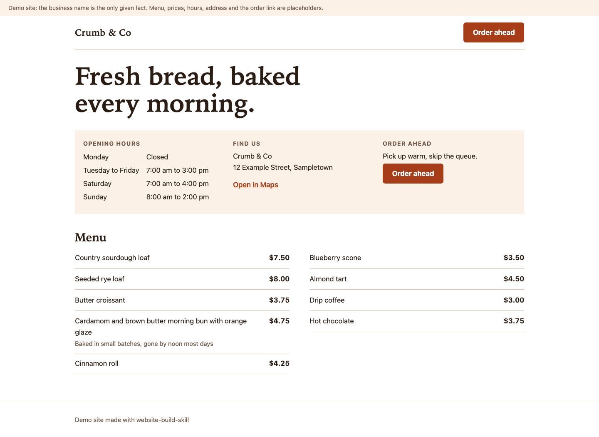
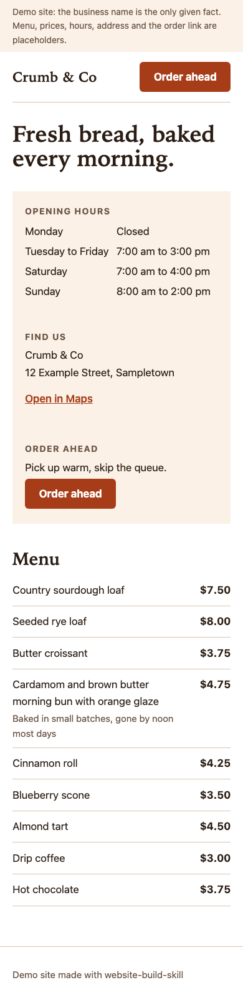

# Real runs

Recorded results of the skill, with the request, visual choices, time and limits kept together.

## Crumb & Co: one-page bakery demo, 2026-10-18

Request: "Build a one-page website for Crumb & Co, a neighbourhood bakery. White background, warm and simple. It needs the menu with prices, opening hours, the address with a map link, and a button to order ahead. Static site, no framework."

**One run, one host (Claude Code), one model (Claude Sonnet 5.5), SOLO. Demo business with placeholder content, not deployed.** The business name was given; menu, prices, hours, address and order link are invented placeholders.

**24 min 48 s of active time, research to proof, one run.** Install took 43 s separately. Time is the sum of stage-boundary wall-clock intervals, including thinking and tool waits. Writing the run log and report afterward is excluded. This is a recorded result with incomplete gates, rather than a forecast for another site.

### Three mockups

Each pair uses the same demo content, including a long headline and dense menu item to test wrapping. These PNGs are copied from the run's actual browser renders.

| Direction | 1440 px | 390 px |
| --- | --- | --- |
| A: Menu First |  |  |
| B: Info Strip, chosen |  |  |
| C: Display Band |  |  |

The operator chose **B: Info Strip** under the trial's instruction to select a direction. It put the action, hours and address near the top, kept the white background and made the menu easy to scan. This was an operator choice, not user approval: BM06 is PASS with exception. Its proposed task-weighted rubric preferred B; the published Awwwards weights preferred A. See the original [selection and flip condition](crumb-and-co/selection.md).

Treat the first mockup as a draft: say what feels off and ask again.

### Built page

The build shortened the headline, used a table for hours, adjusted menu wrapping and added a visible placeholder-content notice. The [HTML](crumb-and-co/index.html) and [CSS](crumb-and-co/styles.css) are unchanged copies; save them together to view locally.

| 1440 px | 390 px |
| --- | --- |
|  |  |

Inspect the original 4x crops: [header](crumb-and-co/built/site-header-4x.png) and [menu](crumb-and-co/built/site-menu-4x.png). The report records layout defects found in renders and fixed before these final images.

### Stages and limits

Stages run: Research, Learn, Ingest, Scope, Match, Mock, Choose, Build and Prove. Protect had local CSP evidence only and was not run as a stage. Challenge and Ship were not run.

| Stage | Active interval | Recorded gate |
| --- | --- | --- |
| Research | 7 min 35 s | AD01-AD08 PASS; AD09 BLOCKED, no different-family reviewer |
| Learn | 0 min 32 s | PASS, library read back |
| Ingest | 0 min 44 s | PASS, role learning receipts |
| Scope | 0 min 45 s | PASS, SOLO acceptance by the same model |
| Match | 1 min 07 s | PASS, brand INFERRED without a kit |
| Mock | 2 min 47 s | BM04 PASS; BM05 PASS with limits |
| Choose | 0 min 25 s | BM06 PASS with exception, operator selection |
| Build | 3 min 46 s | PASS with limits; B09 PARTIAL, order click not exercised |
| Prove | 7 min 07 s | PASS with limits; AX03 PARTIAL, AX07 BLOCKED, PS01 BLOCKED, PS02 UNVERIFIED, S04 BLOCKED |

What stayed blocked or incomplete: independent review, screen-reader testing, Lighthouse, live performance and security checks. Keyboard Tab, 200 percent text zoom, W3C validation, Rich Results Test and the order click were not run. Installer activation remained UNVERIFIED. The complete original gate results, failures, research gaps and exceptions are in [RESULT.md](crumb-and-co/RESULT.md).

### Receipts and source scope

- [Evidence receipt](../evidence/demo-run-crumb-and-co-2026-10-18.json): original install command, environment, stage times, gates and copied artifact hashes.
- [Original run log](../evidence/demo-run-crumb-and-co-2026-10-18-run-log.json): stage boundary timestamps and the active-time definition, copied unchanged.
- [Research sources list](crumb-and-co/sources.md): the run's dated list of 23 opened sources, copied unchanged. Its fetch receipts and the rest of the research library are not included here; sources were not fetched again for this showcase.
- [Packaged text example](../../skills/website-build-skill/examples/crumb-and-co-real-run.md): request, times, selection, gates and gaps without images.

The copied RESULT and selection retain original run-relative references in code spans. Their full file inventories describe the source run; this showcase contains the HTML, CSS, ten PNGs and the three reports linked here, not the entire source project. Gate identifiers are retained so the original limits remain readable against the skill checklists.
